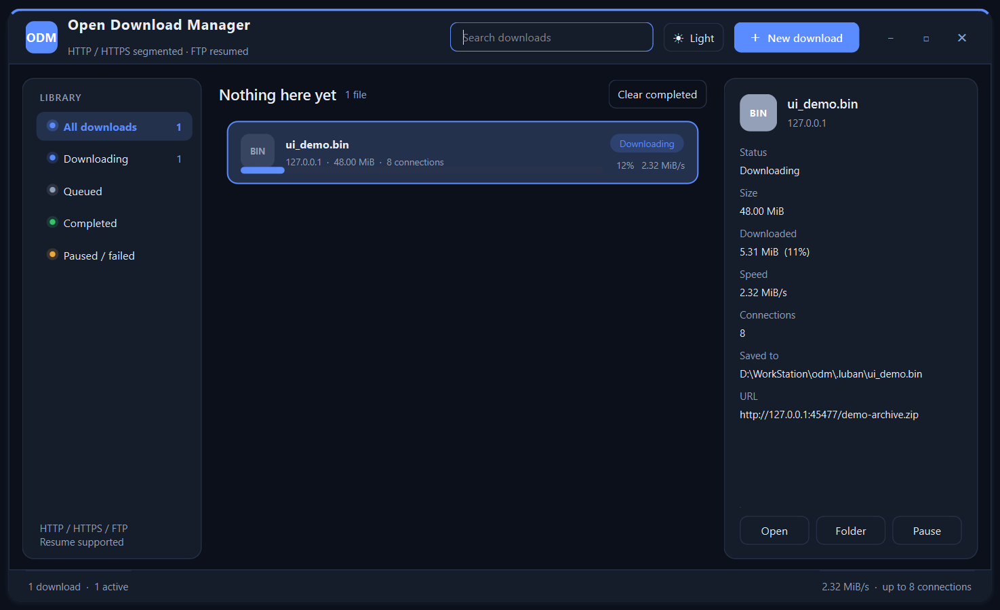

# ODM — Open Download Manager

A download manager with two independent editions in one repository: a native **Windows C++/Qt desktop app** in `cpp/`, and the original **Go/Web edition** at the repository root.


---

## Windows desktop edition (C++ / Qt)

A frameless, hand-painted window over a self-contained C++17 engine. The interface is drawn with `QPainter` instead of stock widgets: a branded header with search and a theme toggle, a library sidebar with live per-category counts, a card list painted by `TaskDelegate`, and a detail panel with the full transfer facts.

| Light | Dark |
| --- | --- |
|  |  |

### What it does

- **Segmented HTTP/HTTPS** — up to 8 parallel connections when the origin honours `Range` and returns a strong `ETag`; otherwise it falls back to a single connection instead of corrupting the file.
- **Crash-safe resume** — partial data lives next to the output as `<filename>.odm-work`; pause, close the app, and retry the same URL and destination to continue.
- **Explicit FTPS** — `AUTH TLS` + `PROT P` over Schannel on both the control and the data connection, with `REST` resume.
- **Legacy Microsoft streaming** — `mms://` and `mmsh://` are fetched over the HTTP tunnel and written as ASF.
- **RTMP capture** — `rtmp://` and `rtmpt://` playback is remuxed into a standards-compliant FLV file.
- **Theme switching at runtime** — the ☀/☾ button re-applies the palette without restarting.

### Supported protocols

| Scheme | Transport | Notes |
| --- | --- | --- |
| `http://` `https://` | WinHTTP | 8-way segmenting, `Range` + `ETag` resume |
| `ftp://` | Passive FTP | `SIZE` / `REST` resume, anonymous or user/password |
| `ftps://` | FTP + TLS (Schannel) | Explicit FTPS: `AUTH TLS`, `PBSZ 0`, `PROT P` |
| `mms://` `mmsh://` | HTTP tunnel | Saved as `.asf` |
| `rtmp://` `rtmpt://` | RTMP / HTTP tunnel | Saved as `.flv` |

### Build

Requires Visual Studio 2022 with *Desktop development with C++*, CMake 3.21+, and Qt 6.5+ for MSVC (tested with 6.8.0). The download engine is Qt-free — configure with `-DODM_GUI=OFF` to build it headless. Tests need Python 3.9+; use `-DBUILD_TESTING=OFF` to skip them.

```cmd
cmake -S cpp -B build-cpp -A x64 -DCMAKE_PREFIX_PATH=C:/Qt/6.8.0/msvc2022_64
cmake --build build-cpp --config Release
ctest --test-dir build-cpp -C Release --output-on-failure
```

Run `build-cpp\Release\odm_desktop.exe` with Qt's `bin` directory on `PATH`, or deploy the Qt dependencies with `windeployqt`.

### Usage

```cmd
odm_desktop.exe https://example.com/file.zip -o D:\Downloads\file.zip --dark
```

| Flag | Meaning |
| --- | --- |
| `<url> ...` | One or more URLs to enqueue on start |
| `-o`, `--output <path>` | Destination for the URL given on the command line |
| `--dark` | Start in the dark palette |
| `--maximized` | Start maximised (`☐` then becomes `❐`) |
| `--screenshot <png>` | Render the window to a file and exit — how the images above are produced |

In the window, click **Add URL**, pick a destination that does not exist yet, then drive the transfer with **Pause** and **Resume / Retry**.

### Tests

`ctest` runs two end-to-end suites against local servers, asserting byte-exact output:

| Test | Covers |
| --- | --- |
| `download` | Segmented HTTP, pause + cross-process resume, no-`Range` fallback, passive FTP with `REST` |
| `stream` | `ftps://` (512 KiB through Schannel), `mmsh://`, `rtmp://` and `rtmpt://` FLV tag-by-tag |

## Go / Web edition

With Go 1.22+, run `go run ./cmd/odm` to open its local web interface, or `go test ./...` for the full suite.

- `internal/engine` — segmented downloads and FTP transfers with resume
- `internal/grabber` — site grabbing
- `internal/api` — local HTTP API and web UI
- `extension/` — Manifest V3 browser module that hands downloads to ODM with referer and cookies
- `cmd/odm` — CLI with IDM-style `/d /p /f /q` switches and a native-messaging host

## Repository layout

```text
cpp/                 Windows desktop edition (engine + Qt shell)
  net.cpp            TCP and Schannel TLS channel
  ftp.cpp mms.cpp    protocol clients
  rtmp.cpp           RTMP playback and FLV muxing
  desktop.cpp        window, cards, palettes
cmd/ internal/       Go edition (API, engine, grabber)
extension/           browser integration module
docs/screenshots/    interface images used by this README
```

## Known limits

- FTPS is explicit (`AUTH TLS`) only; implicit FTPS and `rtmpe://` secure handshakes are not implemented.
- `mms://` captures what the server sends over the HTTP tunnel; it is not a real MMS UDP client.
- Scheduling, browser integration and site grabbing exist only in the Go edition.
