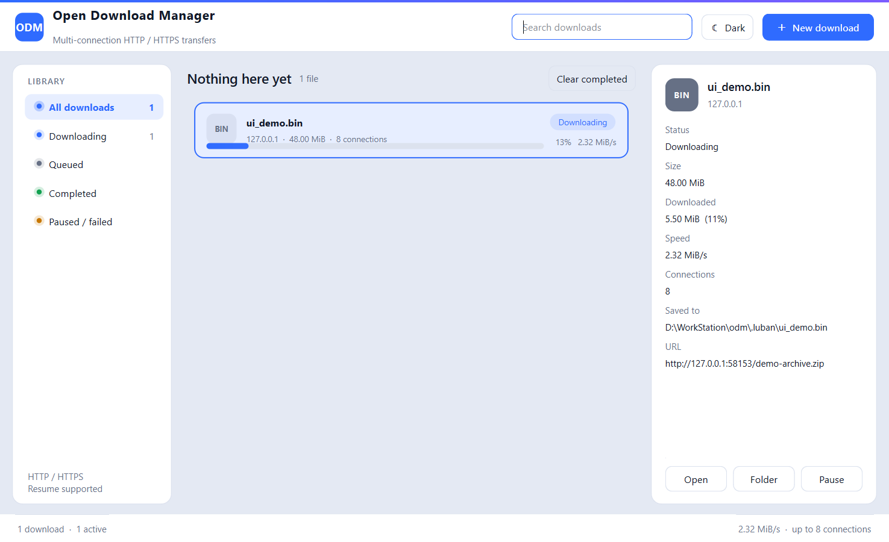

# ODM — Open Download Manager

This repository keeps two independent download managers: the original Go/Web edition and the Windows C++/Qt desktop edition in `cpp/`.

## C++ / Qt desktop edition

Requires Visual Studio 2022 with Desktop development with C++, CMake 3.21+, and Qt 6.5+ for MSVC. The C++17 download engine uses WinHTTP and does not link Qt; configure with `-DODM_GUI=OFF` to build it separately. Tests require Python 3.9+; use `-DBUILD_TESTING=OFF` to omit them.

```cmd
cmake -S cpp -B build-cpp -A x64 -DCMAKE_PREFIX_PATH=C:/Qt/6.8.0/msvc2022_64
cmake --build build-cpp --config Release
ctest --test-dir build-cpp -C Release --output-on-failure
```

### Interface

| Light | Dark |
| --- | --- |
|  |  |

The window is one flat card layout drawn by hand instead of stock widgets: a branded header with search and theme toggle, a library sidebar with live per-category counts, a card list where each row is painted by `TaskDelegate` (file-type badge, name, host/size line, state pill, progress track), and a detail panel with the full transfer facts. `--dark` starts in the dark palette, `--screenshot <png>` renders the window to a file and exits (used for the images above), and the ☀/☾ button switches themes at runtime.

```cmd
odm_desktop.exe https://example.com/file.zip -o D:\Downloads\file.zip --dark
```

Run `build-cpp\Release\odm_desktop.exe` with Qt's `bin` directory on `PATH`, or deploy the Qt dependencies with `windeployqt`. Click **Add URL**, choose a destination that does not already exist, then use **Pause** and **Resume / Retry** to control the transfer.

HTTP(S) origins with byte-range support and a strong ETag can use multiple connections and resume. Otherwise downloads use one connection and restart when retried. To resume after restarting the app, add the same URL and destination again. Partial data lives next to the output in `<filename>.odm-work`; leave it in place to resume. This edition does not yet include FTP, browser integration, site grabbing, or scheduling.

## Go / Web edition

With Go 1.22+, run `go run ./cmd/odm` to open its local web interface, or `go test ./...` to run its tests.
